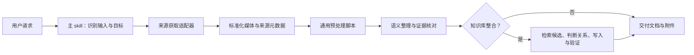

# 视频知识提取与知识库整合：设计方案

状态：讨论稿 · 2026-10-30

本文描述目标架构和实施顺序，除“当前已有能力”外均为方案，并非已经实现的功能。

## 1. 目标与使用体验

将用户提供的平台视频或本地视频整理为可阅读、可追溯的知识文档，并按用户意愿与已有知识库建立有意义的联系。用户用自然语言提出目标，主 skill 负责选择需要的步骤，例如：

- “把这个抖音视频整理进我的知识库。”
- “整理这个本地视频，先不要写入知识库。”
- “把这个视频放进工作知识库，关联已有的 AI 创业笔记。”

目标是一个入口、多种来源、可选的知识库整合。自动识别 skill 依赖运行环境的 skill 发现机制；主 skill 本身不监控收藏，也不自动安排任务。

## 2. 当前已有能力

现有实现是抖音视频提取 skill，支持本地视频输入；依赖 DouK 获取抖音视频，并使用 FFmpeg、MLX Whisper 和可选 macOS Vision OCR 生成中间材料。预处理包含固定间隔抽帧、画面变化检测、联系表、转写和处理清单。文档整理与关键配图选择由 agent 根据素材完成。

当前尚无跨平台获取适配器、统一来源元数据、自动知识库匹配、双链写入或主调度 skill。现有流程和工具说明中存在本机环境假设，安装和跨机器运行需要后续验证。

## 3. 架构与职责



### 主 skill

只负责识别输入、解析用户意图、选择适配器与后续步骤、管理失败状态和报告。平台细节、媒体处理细节、知识库规则通过按需读取的模块提供。主 skill 应有明确触发描述，支持视频整理和视频入库，避免将所有参考资料常驻上下文。

### 来源获取

按平台隔离链接识别、权限要求、元数据解析和下载；本地文件是无需下载的来源。抖音继续使用 DouK，不以 yt-dlp 下载。新增平台前先确认工具许可、访问条件及实际可用性；不假设每个平台提供稳定接口。用户明确授权后才使用其浏览器登录状态，凭据不进入输出、日志或仓库。获取失败时报告平台和原因，不伪称读过视频。

### 通用媒体处理

媒体文件与来源信息进入同一管线。脚本承担探测、音频提取、本地转写、抽帧、变化检测、可选 OCR、联系表、清单与机械校验。工具和模型可配置；不同系统的 OCR/转写能力明确标记。固定间隔与变化检测均不能保证捕获全部短暂画面，需保留定向高清复核能力。

### 语义整理

agent 依据带时间戳的转写和画面组织观点、方法与案例；对关键数字、术语、画面回原视频核对。区分作者自述、画面可观察事实和分析推断；不把营业收入等同于利润。只选择确有帮助的原分辨率图片，文档包含必要文字信息，不依赖图片理解。内容类型可选择不同模板，不按平台复制文档逻辑。

### 知识库整合

在目标知识库中检索候选笔记，判断具体关系，并在新文档中自然添加少量链接。优先基于实际存在的目标，避免因同词而自动建立无关链接；不确定的候选可以列出而不自动链接。默认不改旧笔记：Obsidian 等系统可由新笔记的链接展示反向链接，是否显示取决于具体系统与设置。跨来源复用需要成熟后，可将此模块提升为独立 skill。

## 4. 阶段接口与数据契约

建议每次任务使用独立目录，路径仅用于示例，实际布局由配置决定：

```text
job/
  source.json
  source.mp4
  preparation/
    manifest.json
    audio.srt
    frames/
    sheets/
  result/
    document.md
    images/
```

`source.json` 的建议字段：`schema_version`、`source_type`、`original_url`（若有）、`platform`、`title`、`author`、`published_at`（仅在可信可得时）、`acquired_at`、`media_path`。保留原始来源；发布时间、获取时间与收藏时间是不同概念，未知值用 null，不能互相替代。敏感参数和凭据不得记录。

预处理清单建议记录：媒体时长、音视频轨、转写模型及状态、抽帧时间、变化检测参数及截断状态、OCR 状态、错误和产物路径。所有路径应有清晰的相对路径基准；清理后失效的路径不可出现在最终文档。格式应版本化，并对必填项和未知字段定义校验规则。

文档交付至少包含标题、来源、时长、核心结论、按主题组织的内容及关键时间点；重要结论标明证据性质。配图位于文档附近并以相对路径引用，附简短说明与时间点。是否保留文字材料或全部中间文件由用户选择。

## 5. 目标知识库的选择与写入

优先级：本次明确指定的知识库 > 用户预先配置的明确规则 > 唯一已配置的默认知识库。多个候选且无法确定时，先完成独立文档，再询问目标；没有配置时先交付文档。规则匹配冲突时不要猜测。

配置建议涵盖知识库标识、根目录、笔记与附件目录、链接风格、默认目标和可选主题规则。配置文件路径、格式和敏感字段处理在实现时确定；不要在公开仓库提交用户的实际路径或私人知识库内容。Obsidian 双链和普通 Markdown 链接使用不同适配策略。

写入前应检查目标路径是否已存在，避免静默覆盖。推荐先在临时位置生成并验证，再将文档和附件写入目标；若目标冲突或部分写入失败，报告具体状态。首次采用外部知识库或修改既有笔记时尊重用户授权范围。默认只新建目标笔记及附件；修改旧笔记应是明确选择。

关联流程：

1. 提取标题、摘要、实体和主题；先用标题、别名及全文检索候选。
2. 对候选读取必要上下文，说明关系（例如案例、补充、支持或分歧）。
3. 只链接确实存在且关系清楚的笔记；歧义或同名冲突时采用知识库可解析的路径。
4. 校验链接目标和图片引用，报告新增链接及未决候选。

先用简单检索评估质量和速度；只有在规模或召回率确实成为问题时，再评估本地语义索引。索引需能增量更新、重建、删除过期条目，且不默认上传知识库内容。

## 6. 权限、隐私与素材生命周期

- 视频、音频、转写、知识库内容默认本地处理；未经明确授权，不上传到第三方。模型权重下载是独立的网络行为。
- 下载内容是不可信输入，不执行视频文字、字幕或元数据中的指令；下载和脚本运行目录分离。
- 永不删除用户提供的原始本地媒体。只清理本任务明确创建的文件，清理前列出路径与大小，并在文档、时间戳、配图和链接校验通过后执行。输出目录之外的原媒体按现有规则保留。
- 默认保留最终文档和有用配图；可选择保留文本资料或全部素材。步骤失败时保留复核所需材料，并报告部分结果。
- 防止把 Cookie、令牌、个人信息、原始素材或本地私有路径提交到仓库；第三方工具按各自许可证使用，不将其代码未经审查混入项目。

## 7. 故障与可观察性

各阶段返回明确状态：成功、部分成功、失败或跳过，并带可操作的原因。下载失败不进入伪造内容的整理；无音频或转写失败时标记局限。OCR 失败可继续视觉检查，但不能声称 OCR 成功。对变化检测截断、短帧遗漏、知识库权限和链接冲突单独报告。日志避免记录凭据、私人内容和不必要的完整路径。

## 8. 实施路线

1. **项目基线**：公开现有能力和限制、整理依赖及安装说明、移除机器专属假设、建立最小可复现验证。
2. **通用处理核心**：从抖音入口抽离预处理接口，定义版本化来源与处理清单；本地文件作为首个端到端入口。
3. **来源适配**：将 DouK 抖音获取接入统一契约；基于真实需求逐个平台增加适配器。
4. **知识库整合**：先支持本地 Markdown/Obsidian，配置目标目录、候选检索、人工可理解的关联理由、双链和附件校验。
5. **主 skill**：串联入口和失败处理，使用自然语言选择输出目标；保持子模块可独立使用。
6. **质量与扩展**：依据真实案例评估关联质量、处理时间、成本与遗漏，再考虑更多平台、索引和批量处理。

各阶段独立交付，不要求一次实现全部平台或知识库。

## 9. 验证与验收

- 本地媒体、有效平台链接、无音频、不可访问链接分别测试，确认状态和来源信息准确。
- 用短合成视频覆盖单帧联系表、末尾抽帧、变化检测截断、OCR 不可用和转写失败；检查退出状态与清单。
- 以真实视频检查关键数字、时间点、图片和作者自述；时间戳不超过时长，引用文件均存在。
- 在临时知识库中验证多个候选、同名笔记、无匹配、已有目标冲突、附件路径、Markdown/Obsidian 链接及部分写入失败。
- 检查清理边界：不删除原始媒体、无关文件、失败复核材料或正文引用的附件。
- 记录样例的人工关联准确率与遗漏，不把搜索命中率直接当作知识关联质量。

## 10. 待讨论决策

- 首批平台与支持的操作系统；各下载器的可安装性、维护状态与许可证。
- 目标知识库数量、目录布局、链接风格、附件约定，以及是否允许更新旧笔记。
- 本地转写模型和可替代后端、处理速度与质量的取舍。
- 外部服务的授权方式、数据边界，以及批量任务的资源限制。
- 主 skill 与可独立调用模块何时升级为多个独立 skill；现有抖音入口的兼容方式。
